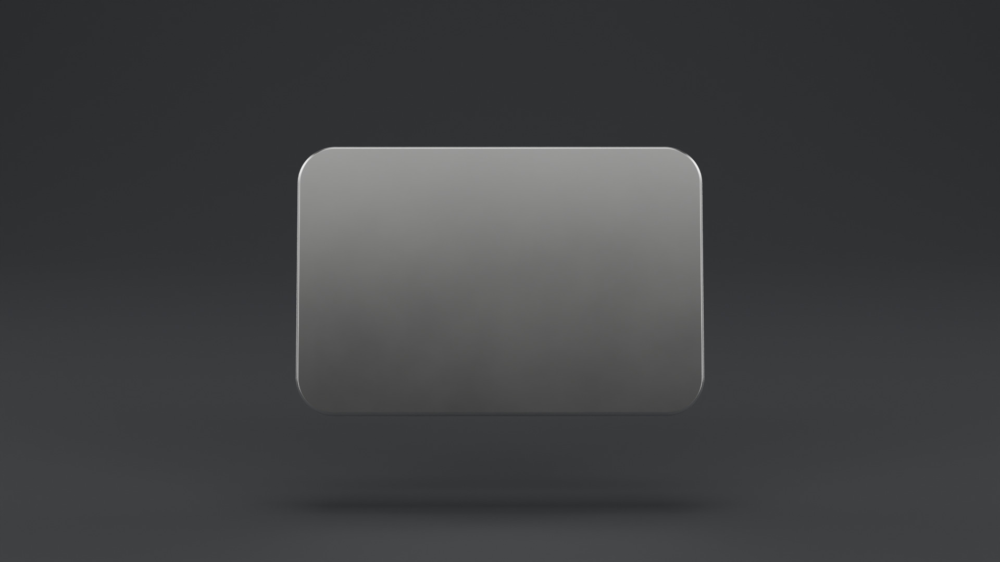
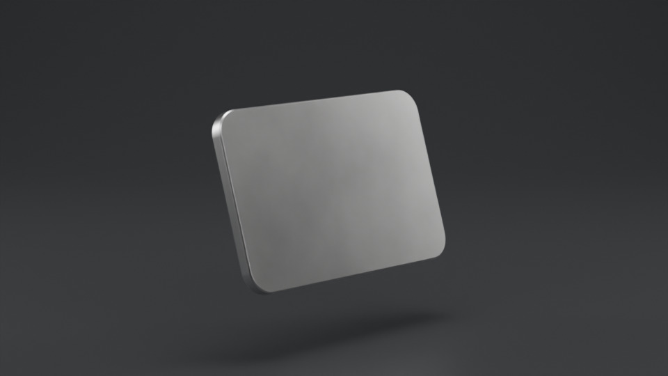
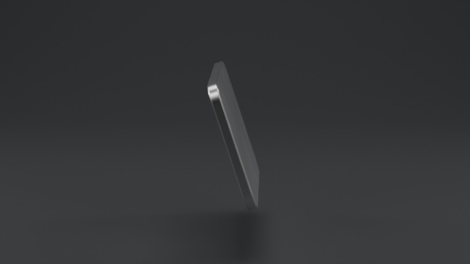
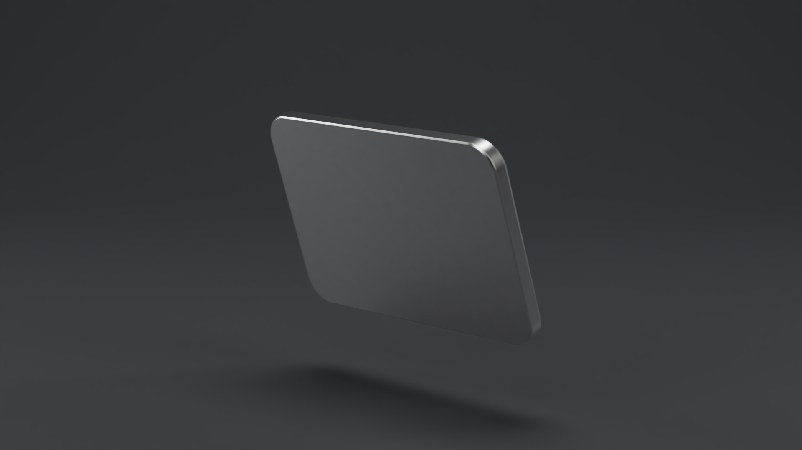
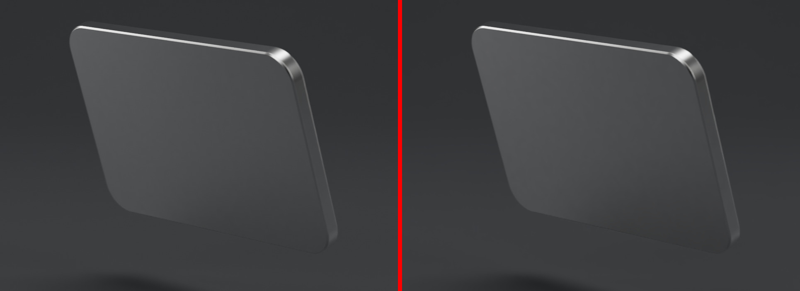

# Aluminum Slab: Photoreal Turntable

Apple 스타일 알루미늄 슬랩(모서리 곡선 + 다이아몬드 컷 챔퍼)을 실사 렌더로 360도 회전 영상까지 뽑는 프로젝트입니다.

## 샘플 렌더



| 회전 중 (30프레임) | 측면 (60프레임) | 후면 (90프레임) |
|---|---|---|
|  |  |  |

정면과 후면은 1080p 최종 품질, 회전 중과 측면은 960 x 540 테스트 렌더입니다.

**렌더 최적화 전후 비교** (왼쪽 33초, 오른쪽 11초, 같은 90프레임)



## 파일 구성

| 경로 | 내용 |
|---|---|
| `aluminum_slab.blend` | 씬 전체 (모델, 재질, 조명, 카메라, 애니메이션, 렌더 설정) |
| `encode_mp4.py` | 렌더된 PNG 프레임을 MP4(H.264)로 묶는 스크립트 |
| `render/frames/` | 최종 프레임이 저장될 곳 (`alu_0001.png` ...) |
| `render/tests/` | 검증용 테스트 렌더 |

## 씬 요약

- **형상**: 실물 치수 24 x 16 x 1.2 cm, 평면 모서리 반경 22 mm(32 분할). 상하 외곽에 1.2 mm 45도 챔퍼, 챔퍼 경계에 0.15 mm 마이크로 라운드(실제 가공 엣지는 칼날처럼 날카롭지 않음). Weighted Normal로 큰 평면의 음영 왜곡 제거.
- **재질**
  - `Alu_BeadBlasted` (본체): 비드 블라스트 후 아노다이징한 실버. Metallic 1, F0 (0.88, 0.885, 0.89), 엣지 틴트(F82) 적용, 거칠기 0.235~0.25 미세 변화, 0.1 mm 입자 범프.
  - `Alu_DiamondCut` (챔퍼): 경면 가공 알루미늄. 거칠기 0.05~0.09.
- **조명**: 어두운 차콜 사이클로라마 + 발광 패널 소프트박스(카메라와 그림자에는 안 보이고 반사에만 보임). 정면 그라데이션 패널, 45도 좌우 패널, 후방 스트립 2개, 상단 소프트박스, 배경 글로우.
- **카메라**: 100 mm, f/11, 피벗에 초점.
- **애니메이션**: 30 fps, 1~240 프레임(8초), 선형 360도 회전. 241 = 1 프레임이라 반복 재생 시 이음매 없음.
- **렌더**: Cycles GPU(Metal), 1920x1080, 적응형 샘플링(임계 0.02, 최대 256), 광택 반사 4회, 확산 2회, 커스틱 끔, Persistent Data 켬, OIDN 디노이즈, 모션 블러, AgX Medium High Contrast.
- **측정치**: M3 Pro 기준 1080p 프레임당 약 11~12초, 전체 240프레임 약 45분 (최적화 전 33초 대비 화질 차이 PSNR 47 dB로 육안 구분 불가).

## 영상 출력 방법 (권장: 프레임 시퀀스 후 인코딩)

MP4로 바로 렌더하면 중간에 멈췄을 때 전체를 다시 렌더해야 합니다. PNG 시퀀스로 뽑으면 이어서 렌더할 수 있고, 인코딩 설정도 렌더 없이 몇 초 만에 다시 바꿀 수 있습니다. 출력 경로와 포맷은 이미 `.blend`에 설정되어 있습니다.

### 1단계: 프레임 렌더

**A. 터미널 백그라운드 렌더 (가장 빠름, 권장)**

Blender 창을 닫고 프로젝트 폴더에서:

```bash
cd ~/Documents/GitHub/blender-render
/Applications/Blender.app/Contents/MacOS/Blender -b aluminum_slab.blend -a
```

- UI를 그리지 않아 GUI 렌더보다 빠르고 메모리도 덜 씁니다.
- 일부 구간만: `-s 1 -e 60 -a` (1~60 프레임)
- 중단 후 같은 명령을 다시 실행하면 이미 있는 프레임은 건너뜁니다(Overwrite 꺼짐, Placeholders 켜짐).

**B. Blender GUI에서**

`aluminum_slab.blend` 열기, 상단 메뉴 `Render > Render Animation`.

### 2단계: MP4 인코딩

```bash
cd ~/Documents/GitHub/blender-render
/Applications/Blender.app/Contents/MacOS/Blender -b -P encode_mp4.py
```

결과물: `render/aluminum_slab.mp4` (H.264, 거의 무손실 CRF, 30 fps, yuv420p). 다른 경로나 fps를 쓰려면:

```bash
/Applications/Blender.app/Contents/MacOS/Blender -b -P encode_mp4.py -- render/frames render/out.mp4 30
```

ffmpeg가 설치되어 있다면 아래 명령도 같은 결과를 냅니다.

```bash
ffmpeg -framerate 30 -i render/frames/alu_%04d.png -c:v libx264 -crf 14 -preset slow \
       -pix_fmt yuv420p -movflags +faststart render/aluminum_slab.mp4
```

편집용 원본이 필요하면 `-c:v prores_ks -profile:v 3 -pix_fmt yuv422p10le render/aluminum_slab.mov` (ProRes 422 HQ).

### (대안) MP4로 바로 렌더

`Output Properties > Output`에서 File Format을 `FFmpeg Video`, Container `MPEG-4`, Codec `H.264`, Output Quality `Perceptually Lossless`로 바꾸고 Render Animation. 간단하지만 중단 시 처음부터 다시 렌더해야 합니다.

## 시간과 품질 조절

| 목적 | 바꿀 곳 | 값 |
|---|---|---|
| 빠른 미리보기 | Output > Resolution % | 50% (약 4배 빠름) |
| 빠른 미리보기 | Render > Sampling > Max Samples | 128 |
| 4K 납품 | Output > Resolution | 3840 x 2160 (약 4배 느림) |
| 길이 변경 | 타임라인 End + 피벗 Z 회전 키 위치 | 예: 10초면 End 300, 360도 키를 301로 |
| 더 느린 회전 | 같은 길이에서 회전각 축소 | 360도 대신 180도 |

## 자주 바꾸는 디자인 값

- **스페이스 그레이**: `Alu_BeadBlasted`의 Base Color를 (0.30, 0.31, 0.33) 정도로, Specular Tint를 (0.55, 0.56, 0.58) 정도로.
- **더 광택 있는 면**: `Alu_BeadBlasted`의 Map Range `To Min/To Max`를 0.15 / 0.17로.
- **반사 그라데이션 위치**: `SB_FrontGradient` 패널을 위아래로 옮기면 정면의 밝은 영역이 이동합니다.
- **배경 밝기**: `Backdrop_Glow` 라이트의 Power, `Backdrop` 재질 Base Color.

## 클라우드 4K 렌더

업로드용 파일은 `aluminum_slab_4k.blend` (3840 x 2160, 외부 파일 참조 없음, 이 파일 하나만 올리면 됨)입니다.

### A. 렌더팜 서비스 (웹 업로드, 가장 쉬움)

1. Blender 5.2를 지원하는 GPU 렌더팜에 가입 (대부분 첫 가입 무료 크레딧 제공).
2. `aluminum_slab_4k.blend` 업로드, Blender 버전 5.2, GPU 노드, 프레임 1~240 선택.
3. 먼저 테스트 렌더(몇 프레임)로 비용과 시간 확인 후 전체 렌더.
4. 프레임 다운로드 후 로컬에서 인코딩:
   `Blender -b -P encode_mp4.py -- <다운받은_프레임_폴더> render/aluminum_slab_4k.mp4 30`

### B. GPU 서버 시간 대여 (터미널, 가장 저렴)

```bash
# 로컬 → 서버 업로드
scp aluminum_slab_4k.blend render_on_gpu_server.sh USER@SERVER:~/job/
ssh USER@SERVER
cd ~/job && bash render_on_gpu_server.sh        # 테스트 1프레임 → 예상 시간 출력 → 전체 렌더 → frames_4k.tar
exit

# 서버 → 로컬 다운로드 후 인코딩
mkdir -p render/4k && scp USER@SERVER:~/job/frames_4k.tar render/4k/ && tar -xf render/4k/frames_4k.tar -C render/4k
/Applications/Blender.app/Contents/MacOS/Blender -b -P encode_mp4.py -- render/4k/frames render/aluminum_slab_4k.mp4 30
```

끝나면 반드시 서버를 종료하세요. 대여 서버는 렌더가 끝나도 켜져 있는 동안 계속 과금됩니다.
